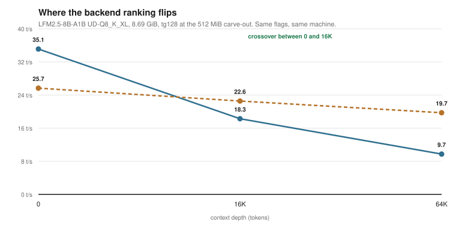
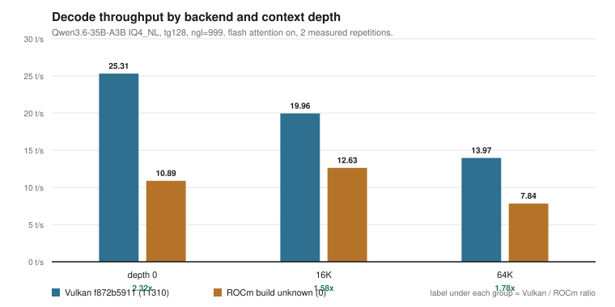
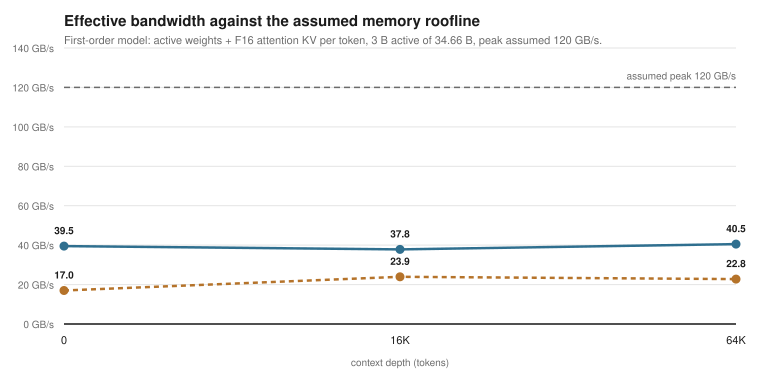
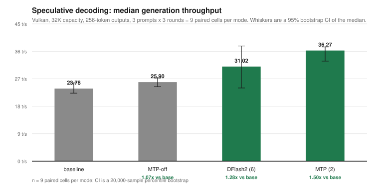

# igpu-llm-bench

**Which backend is faster for local LLM inference on an AMD integrated GPU?
It depends on the model size and the context depth — and for a mid-sized model
the answer reverses.**

This repository contains a controlled Vulkan-vs-ROCm comparison at a fixed
512 MiB carve-out, a first-order memory roofline, the raw logs, and the scripts
that regenerate every table. The archived "2.3x" headline is kept, but demoted:
it compares two different memory settings and cannot be reproduced at one.

---

## TL;DR

- **Controlled A/B, same 512 MiB carve-out, same flags, same models.** On a
  4 GiB MoE model Vulkan is faster at every depth (**1.27x–1.42x**). On an
  8.7 GiB model of the same architecture, Vulkan is faster at depth 0 (1.37x)
  but **ROCm is faster at 16K (1.23x) and 64K (2.03x)**.
- **The 35B model only runs on ROCm at this setting.** Vulkan's addressable
  budget is ~14.5 GiB; the model is 17.25 GiB. ROCm loads it through unified
  memory and decodes at **17.66 t/s** (depth 0), 14.54 t/s at 16K. No Vulkan
  number exists, and none can.
- **The archived 2.32x is real but cross-setting.** Vulkan was measured at
  16 GB, ROCm at 0.5 GB, because that is the only setting where each could run
  the 35B. It is not a controlled effect size.
- **IQ4 is dequantization-bound, not bandwidth-bound.** Halving the bytes per
  token (IQ4 vs Q8, same model) buys only ~20% throughput, so effective
  bandwidth *halves*: 22.5 GB/s vs 38.7 GB/s against an assumed 120 GB/s peak.
- **MTP is a clear win (1.51x); DFlash2 is marginal (1.28x, CI 1.00–1.56).**

## 1. Controlled comparison at 0.5 GB

Same carve-out, same CLI (`-ngl 999 -fa on -t 12 -b 2048 -ub 512 -p 512 -n 128`),
same depths, one discarded warmup per model, nothing else running.

`tg128`. Ratio is Vulkan / ROCm: above 1 means Vulkan faster.

| Model | Size | Depth | Vulkan | ROCm | V/ROCm | Winner |
|---|---|---:|---:|---:|---:|---|
| LFM2.5-8B-A1B IQ4 | 4.05 GiB | 0 | 43.88 | 30.97 | 1.42x | Vulkan |
| LFM2.5-8B-A1B IQ4 | 4.05 GiB | 16K | 30.32 | 22.38 | 1.35x | Vulkan |
| LFM2.5-8B-A1B Q8 | 8.69 GiB | 0 | 35.12 | 25.66 | 1.37x | Vulkan |
| LFM2.5-8B-A1B Q8 | 8.69 GiB | 16K | 18.27 | 22.55 | 0.81x | **ROCm** |
| LFM2.5-8B-A1B Q8 | 8.69 GiB | 64K | 9.74 | 19.72 | 0.49x | **ROCm** |
| Qwen3-VL-4B Q8 (dense) | 4.70 GiB | 0 | 11.74 | 10.34 | 1.14x | Vulkan |
| Qwen3-VL-4B Q8 (dense) | 4.70 GiB | 16K | 5.46 | 6.40 | 0.85x | **ROCm** |
| Qwen3.6-35B-A3B-MTP | 17.25 GiB | 0 | — | 17.66 | — | ROCm only |
| Qwen3.6-35B-A3B-MTP | 17.25 GiB | 16K | — | 14.54 | — | ROCm only |

Full table, including the Q8_0 KV rows and the noisy rows that were excluded:
[`docs/related/backend-comparison-512mb.md`](docs/related/backend-comparison-512mb.md).



**The crossover is the finding.** Vulkan's throughput falls 72% from depth 0 to
64K on the 8.69 GiB model; ROCm's falls 23%. Something about the larger model at
long context favours ROCm's unified-memory path. Three hypotheses — memory
pressure, long-context kernel behaviour, thermal drift — are listed in the doc.
None is tested.

## 2. Why the archive says 2.3x

The archived pair is `tg128`, 16.79 GiB target, same machine:

| Backend | Build | t/s | ± |
|---|---|---:|---:|
| Vulkan | `f872b5911 (11310)` | **25.31** | 0.75 |
| ROCm | `unknown (0)` | **10.89** | 1.61 |

Raw ratio **2.32x**. It is not a controlled comparison, for a reason that is now
measured rather than suspected:

- At 512 MiB, Vulkan's total budget is ~14.5 GiB, below the 16.79 GiB model, so
  the archived Vulkan run cannot have used that setting.
- At 16 GB, ROCm cannot allocate the model: the weight buffer is 16,679.34 MiB and
  the pool is 16,384 MiB.

So **there is no carve-out where both backends can fully offload the 35B.** The
2.32x compares each backend at its only workable setting. Treat it as a
capability-and-speed observation, not an effect size.



## 3. The roofline: IQ4 is not bandwidth-bound

At depth 0 the KV cache is negligible, so per-token traffic is dominated by the
active weights. Effective bandwidth = active-weight bytes × t/s.

| Model | Active GB/token | t/s | Effective GB/s | % of 120 |
|---|---:|---:|---:|---:|
| LFM IQ4_NL | 0.513 | 43.88 | 22.5 | 18.8% |
| LFM Q8_K_XL | 1.102 | 35.12 | 38.7 | 32.2% |
| Qwen3-VL 4B dense Q8 | 5.021 | 11.74 | 59.0 | 49.1% |
| Qwen3.6-35B MTP (ROCm) | 1.565 | 17.66 | 27.6 | 23.0% |

The IQ4 model moves **half the bytes** of the Q8 model and runs only ~20%
faster. If decode were bandwidth-bound, it should be about twice as fast. It
isn't, so the IQ4 path is spending time somewhere else — most plausibly
dequantization. That is hypothesis H1, now with a measurement behind it.

The dense 4B model reaches 49% of the assumed peak, the MoE Q8 model 32%. The
gap between those two is consistent with expert-routing overhead (H2), but the
two models differ in more than routing, so it is not isolated.



Full argument and the five hypotheses: [`analysis/roofline.md`](analysis/roofline.md).

## 4. Speculative decoding

Vulkan, 32K capacity, 256-token outputs, 3 prompts × 3 rounds, paired by
(prompt, round):

| Mode | Median generation t/s | Paired speedup | 95% CI |
|---|---:|---:|---|
| Baseline | 23.78 | 1.00x | — |
| DFlash2, 6 drafts | 31.02 | 1.28x | 1.00–1.56 |
| MTP, 2 drafts | **36.27** | **1.51x** | 1.37–1.63 |

MTP clears 1.00 comfortably. DFlash2 does not: at n=9 it is not distinguishable
from noise for every prompt, and the per-cell range is 0.94–1.69.



## Hardware

| Component | Value |
|---|---|
| CPU | AMD Ryzen AI 9 HX 375, 12C/24T, 24 MiB L3 |
| iGPU | Radeon 890M, `gfx1150`, RADV STRIX1, Mesa 26.0.8 |
| Memory | 32 GB LPDDR5X (30 GiB visible); exact speed not recorded |
| Carve-out used for §1 | **512 MiB VRAM + 15,439 MiB GTT, 30,878 MiB host** |
| Carve-out in the archive | both 0.5 GB and 16 GB were used |
| Kernel | `7.0.0-42-generic`; archived runs on `7.0.0-38-generic` |
| NPU | `amdxdna` loaded, `/dev/accel/accel0` present; **unused** |
| llama.cpp | `f872b591121761ac7b2af18283bd99bdc092a63a` |
| ROCm | HIP 7.15.26333, image `518ced857e9b…` — **not ROCm 10** |

Details, including the two carve-out settings and why ROCm cannot load the 35B
at 16 GB: [`docs/hardware.md`](docs/hardware.md).

## Reproduce

Model weights are not included. The controlled comparison needs only the small
models; the 35B needs the MTP variant.

```bash
export LLAMA_BENCH=$HOME/llama.cpp/build-vulkan/bin/llama-bench
export MODELS_DIR=$HOME/models

make campaign                      # Vulkan matrix, ~15 min
python3 scripts/campaign_summary.py runs/campaign-*/campaign.csv
python3 scripts/compare_backends.py --vulkan ... --rocm ...
```

The ROCm arm runs inside the archived image:

```bash
python3 scripts/campaign.py \
  --llama-bench $HOME/llama.cpp/build-rocm/bin/llama-bench \
  --container docker.io/rocm/dev-ubuntu-24.04:latest \
  --mount "$HOME/LLM:/LLM" --model-root "$HOME/LLM/LLMs:/LLM/LLMs" \
  --warmup --include-large
```

`--device /dev/kfd` is required; without it HIP silently falls back to CPU, and
`campaign.py` now refuses to record a run when it sees that message.

Step-by-step, with the failure modes ordered by frequency:
[`docs/reproduction-checklist.md`](docs/reproduction-checklist.md).

## What is in here

| Path | What it is |
|---|---|
| `README.md` | This file |
| `RESULTS.md` | Every table, one row per run, each with a source |
| `docs/related/backend-comparison-512mb.md` | The controlled A/B, in full |
| `docs/methodology.md` | Flags, repetitions, warmup, protocols |
| `docs/hardware.md` | CPU, iGPU, RAM, both carve-outs, model architecture |
| `docs/limitations.md` | Confounds, missing data, what would close each gap |
| `docs/glossary.md` | tg128, GTT, A3B, KV cache, draft acceptance |
| `docs/faq.md` | Troubleshooting and interpretation |
| `docs/references.md` | What is cited, and what is deliberately not |
| `docs/reproduction-checklist.md` | Preflight → run → compare → publish |
| `docs/privacy.md` | Redaction log and secret-scan results |
| `docs/figures/` | Generated SVG figures, no plotting dependency |
| `data/raw/` | Sanitised original logs and historical records |
| `data/processed/` | CSV/JSON parsed from the raw files |
| `data/processed/runs-index.csv` | One row per reported run, with its source |
| `data/provenance.md` | File → source → date → transformation |
| `scripts/bench.sh` | One-shot `llama-bench` wrapper |
| `scripts/campaign.py` | Matrix runner with sensors and CPU-fallback guard |
| `scripts/capacity_probe.py` | How much of a model can be offloaded |
| `scripts/compare_backends.py` | Join Vulkan and ROCm runs into a ratio table |
| `scripts/stats.py` | Paired ratios and bootstrap intervals |
| `scripts/roofline.py`, `scripts/roofline_campaign.py` | Bandwidth models |
| `scripts/chart.py` | Data → dependency-free SVG |
| `scripts/verify_results.py` | Fails if the docs disagree with the data |
| `scripts/secret_scan.py` | Privacy and credential scan |
| `analysis/roofline.md` | The written roofline argument |
| `docker/rocm-ubuntu26.04.Dockerfile` | Archived ROCm 10 build recipe (not the measured runtime) |

## What this is not

- **Not a general backend ranking.** It ranks them at 512 MiB, on one iGPU, for
  these models. The crossover point may move on other hardware.
- **Not an explanation.** The depth reversal is measured; its cause is not.
- **Not a 35B comparison.** Only ROCm can run the 35B at this setting.
- **Not ROCm 10.** The measured runtime is HIP 7.15.
- **Not thermally controlled.** The GPU reached 87–96 °C; run order was fixed.
- **Not boot-level replicated.** One session per configuration.

## Open questions

1. **Randomise run order and repeat**, to separate the depth crossover from
   thermal drift.
2. **Find the crossover depth** precisely (between 0 and 16K for the 8.7 GiB
   model).
3. **Test the mechanism**: does Vulkan's throughput recover at 64K if the model
   is smaller, or the KV is quantized?
4. **A 35B comparison at one setting** — only possible with reduced offload on
   both backends at 16 GB, which changes the carve-out.
5. **ROCm 10**, to see whether the newer stack changes the crossover.

## Verifying the numbers

```bash
make check        # regenerate, verify docs against data, scan for secrets
```

`verify_results.py` fails if a headline number is absent from the generated
CSVs, or if a known stale value survives. CI runs the same checks.

## Licence and privacy

Code is MIT — [`LICENSE`](LICENSE). Text, tables, logs, CSV, and JSON are
CC BY 4.0 — [`LICENSE-DATA`](LICENSE-DATA). Model weights are not included.

The repository is private and contains no weights, tokens, keys, emails, MAC
addresses, serial numbers, or personal names. Redaction log:
[`docs/privacy.md`](docs/privacy.md). Citation: [`CITATION.cff`](CITATION.cff).
Changes: [`CHANGELOG.md`](CHANGELOG.md).
