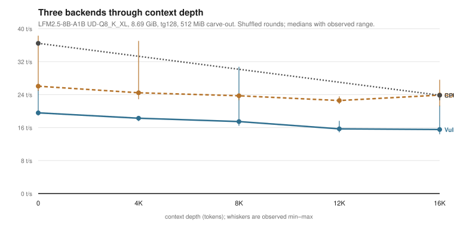
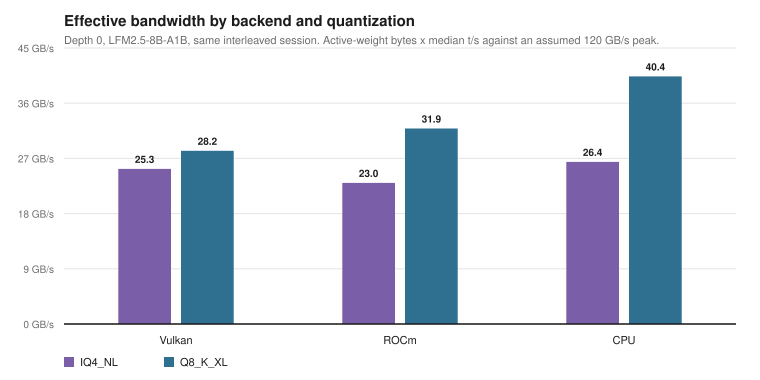

# igpu-llm-bench

**Which backend is faster for local LLM inference on an AMD integrated GPU?
It depends on the model size and the context depth — and for a mid-sized model
the answer reverses.**

This repository contains a controlled Vulkan-vs-ROCm comparison at a fixed
512 MiB carve-out, a first-order memory roofline, the raw logs, and the scripts
that regenerate every table. The archived "2.3x" headline is kept, but demoted:
it compares two different memory settings and cannot be reproduced at one.

---

## TL;DR

- **The iGPU is not automatically faster than the CPU.** At short context the
  CPU wins for every model tested, including the 35B: 36.5 vs 30.6 (ROCm) and
  24.0 (Vulkan) t/s on the 8.69 GiB model.
- **ROCm is the most consistent GPU backend.** It beats Vulkan at every depth
  measured, by 1.28x at depth 0 and 1.60x at 16K, and wins in all three
  randomised rounds at 16K.
- **Vulkan is the most variable.** The same command gives 18.7–35.2 t/s at depth
  0 across six repetitions. An earlier single-session value of 35.12 was the top
  of that distribution, not the typical value; the "Vulkan wins at depth 0"
  claim did not survive randomisation.
- **The 35B is a capacity problem first.** At 512 MiB, ROCm loads it via unified
  memory (17.66 t/s), the CPU runs it at 18.38 t/s, and Vulkan could not load it
  with the desktop running.
- **4-bit quantization is not free.** IQ4 moves half the bytes per token of Q8
  for the same model but runs only ~20% faster, so effective bandwidth halves:
  22.5 vs 38.7 GB/s against an assumed 120 GB/s peak.
- **MTP is a clear win (1.51x); DFlash2 is marginal (1.28x, CI 1.00–1.56).**
- **At the 16 GB carve-out the 35B finally runs on Vulkan: 24.19 t/s at depth 0,
  20.45 at 16K, 14.68 at 64K** (5, 5 and 2 repetitions; spread under 1%). Small models also decode
  1.4–3.0x faster than at 0.5 GB, at the cost of host RAM.

## 1. Vulkan, ROCm and CPU at 0.5 GB

Same carve-out, same flags, backends interleaved with **shuffled round order**.

8.69 GiB MoE model, `tg128`, medians across rounds:

| Depth | Vulkan | ROCm | CPU |
|---:|---:|---:|---:|
| 0 | 23.97 | 30.61 | **36.70** |
| 4K | 18.28 | 24.45 | — |
| 8K | 17.46 | 23.72 | — |
| 12K | 15.70 | 22.56 | — |
| 16K | 16.31 | **26.14** | 23.85 |

Depth 0, six repetitions, same command each time:

| Backend | Median | Range | sd |
|---|---:|---:|---:|
| Vulkan | 23.97 | 18.66–35.19 | 5.99 |
| ROCm | 30.61 | 26.93–34.55 | 3.13 |
| CPU | 36.70 | 35.87–36.59 | 0.36 |

The other models at depth 0:

| Model | Size | CPU | Vulkan | ROCm |
|---|---|---:|---:|---:|
| LFM IQ4_NL | 4.05 GiB | **51.99** | 43.88 | 30.97 |
| LFM Q8_K_XL | 8.69 GiB | **36.70** | 23.97 | 30.61 |
| Qwen3-VL-4B Q8 (dense) | 4.70 GiB | **14.81** | 11.74 | 10.34 |
| Qwen3.6-35B-A3B-MTP | 17.25 GiB | **18.38** | — | 17.66 |

Full method, ranges, order checks and caveats:
[`docs/related/backend-comparison-512mb.md`](docs/related/backend-comparison-512mb.md).



**Why the CPU wins at short context:** decode streams the active weights once
per token, and the CPU and iGPU read the same LPDDR5X through the same memory
controller. The CPU has no driver or command-submission overhead. Prefill shows
the opposite — 1,025 t/s on Vulkan vs 264 t/s on CPU for the same model — so the
GPU is the right tool when the work is compute-dense. The numbers are measured;
the mechanism is a hypothesis.

## 1b. The other carve-out: 16 GB

The carve-out is settable from Linux. At 16 GB (24,022 MiB GPU-addressable,
15,277 MiB host) decode improves sharply, and the 35B becomes runnable on
Vulkan:

| Workload | 0.5 GB | 16 GB |
|---|---:|---:|
| LFM IQ4, depth 0 | 42.58 | 71.97 |
| LFM IQ4, 16K | 42.10 | 60.82 |
| LFM IQ4, 64K | 20.63 | 44.17 |
| LFM Q8, 64K | 9.74 | 28.87 |
| Qwen3-VL-4B, 16K | 5.46 | 12.54 |
| **35B, Vulkan, depth 0** | **fails to load** | **24.19** |
| 35B, ROCm, depth 0 | 17.66 | fails (5.00 at `-ngl 22`) |
| 35B, CPU, depth 0 | 18.38 | 13.78 |

Prefill at 64K is the exception: it is 0.56–0.61x of the 0.5 GB value, and the
GPU reached 99 °C, so the comparison is thermally confounded.

All 35B numbers here use the **MTP variant** (17.25 GiB, 35.51 B, 41 layers).
The archived comparison used a different file (16.79 GiB, 34.66 B, 40 layers)
that is not on disk, so the two are not directly comparable. Full tables:
[`RESULTS.md` §8](RESULTS.md).

## 2. Why the archive says 2.3x

The archived pair is `tg128`, 16.79 GiB target, same machine:

| Backend | Build | t/s | ± |
|---|---|---:|---:|
| Vulkan | `f872b5911 (11310)` | **25.31** | 0.75 |
| ROCm | `unknown (0)` | **10.89** | 1.61 |

Raw ratio **2.32x**. It is not a controlled comparison, for a reason that is now
measured rather than suspected:

- At 512 MiB, Vulkan reports 15,950 MiB total and 14,814 MiB free, below the
  16.79 GiB model, so the archived Vulkan run cannot have used that setting.
  (That is arithmetic about total addressable memory; it is separate from the
  desktop-VRAM exhaustion that blocks the 17.25 GiB model today.)
- At 16 GB, ROCm cannot allocate the model: the weight buffer is 16,679.34 MiB and
  the pool is 16,384 MiB.

So **there is no carve-out where both backends can fully offload the 35B.** The
2.32x compares each backend at its only workable setting. Treat it as a
capability-and-speed observation, not an effect size.


## 3. The roofline: quantization costs more than bytes

At depth 0 the KV cache is negligible, so per-token traffic is dominated by the
active weights. Same-session, interleaved, medians of four rounds:

| Backend | Quant | Active GB/token | t/s | Effective GB/s | % of 120 |
|---|---|---:|---:|---:|---:|
| Vulkan | IQ4_NL | 0.513 | 49.30 | 25.3 | 21.1% |
| Vulkan | Q8_K_XL | 1.102 | 25.63 | 28.2 | 23.5% |
| ROCm | IQ4_NL | 0.513 | 44.86 | 23.0 | 19.2% |
| ROCm | Q8_K_XL | 1.102 | 28.93 | 31.9 | 26.6% |
| CPU | IQ4_NL | 0.513 | 51.50 | 26.4 | 22.0% |
| CPU | Q8_K_XL | 1.102 | 36.64 | 40.4 | 33.6% |

The Q8 file carries **2.15x** the bytes per token of the IQ4 file. If decode
were purely bandwidth-bound, IQ4 should be 2.15x faster. It is not:

| Backend | IQ4/Q8 throughput | vs 2.15x bytes |
|---|---:|---:|
| Vulkan | 1.92x | close to bandwidth-bound |
| ROCm | 1.55x | more overhead |
| CPU | 1.41x | most overhead |

Equivalently, Q8 achieves a **higher effective bandwidth than IQ4 on every
backend** (for example 40.4 vs 26.4 GB/s on the CPU). The 4-bit path is not
getting the full benefit of its smaller footprint; it is paying a dequantization
cost. The penalty is smallest on Vulkan and largest on the CPU.

None of the three reaches half of the assumed 120 GB/s peak. The best is the CPU
on Q8 at 34%.



Full argument and the five hypotheses: [`analysis/roofline.md`](analysis/roofline.md).

## 4. Speculative decoding

Vulkan, 32K capacity, 256-token outputs, 3 prompts × 3 rounds, paired by
(prompt, round):

| Mode | Median generation t/s | Paired speedup | 95% CI |
|---|---:|---:|---|
| Baseline | 23.78 | 1.00x | — |
| DFlash2, 6 drafts | 31.02 | 1.28x | 1.00–1.56 |
| MTP, 2 drafts | **36.27** | **1.51x** | 1.37–1.63 |

MTP clears 1.00 comfortably. DFlash2 does not: at n=9 it is not distinguishable
from noise for every prompt, and the per-cell range is 0.94–1.69.


## Hardware

| Component | Value |
|---|---|
| CPU | AMD Ryzen AI 9 HX 375, 12C/24T, 24 MiB L3 |
| iGPU | Radeon 890M, `gfx1150`, RADV STRIX1, Mesa 26.0.8 |
| Memory | 32 GB LPDDR5X (30 GiB visible); exact speed not recorded |
| Carve-out used for §1 | **512 MiB VRAM + 15,439 MiB GTT, 30,878 MiB host** |
| Carve-out control | `card*/device/uma/carveout` (index 0–7) or `amd-smi set -m` |
| Carve-out in the archive | both 0.5 GB and 16 GB were used |
| Kernel | `7.0.0-42-generic`; archived runs on `7.0.0-38-generic` |
| NPU | `amdxdna` loaded, `/dev/accel/accel0` present; **unused** |
| llama.cpp | `f872b591121761ac7b2af18283bd99bdc092a63a` |
| ROCm | **10.0.0** (image `518ced857e9b…`, HIP 7.15.26333) |

Details, including the two carve-out settings and why ROCm cannot load the 35B
at 16 GB: [`docs/hardware.md`](docs/hardware.md).

## Reproduce

Model weights are not included. The controlled comparison needs only the small
models; the 35B needs the MTP variant.

```bash
export LLAMA_BENCH=$HOME/llama.cpp/build-vulkan/bin/llama-bench
export MODELS_DIR=$HOME/models

./scripts/carveout.sh --show       # current VRAM carve-out and GTT
make campaign                      # Vulkan matrix, ~15 min
python3 scripts/campaign_summary.py runs/campaign-*/campaign.csv
python3 scripts/compare_backends.py --vulkan ... --rocm ...
```

The ROCm arm runs inside the archived image:

```bash
python3 scripts/campaign.py \
  --llama-bench $HOME/llama.cpp/build-rocm/bin/llama-bench \
  --container docker.io/rocm/dev-ubuntu-24.04:latest \
  --mount "$HOME/LLM:/LLM" --model-root "$HOME/LLM/LLMs:/LLM/LLMs" \
  --warmup --include-large
```

`--device /dev/kfd` is required; without it HIP silently falls back to CPU, and
`campaign.py` now refuses to record a run when it sees that message.

Step-by-step, with the failure modes ordered by frequency:
[`docs/reproduction-checklist.md`](docs/reproduction-checklist.md).

## What is in here

| Path | What it is |
|---|---|
| `README.md` | This file |
| `RESULTS.md` | Every table, one row per run, each with a source |
| `docs/related/backend-comparison-512mb.md` | The controlled A/B, in full |
| `docs/methodology.md` | Flags, repetitions, warmup, protocols |
| `docs/hardware.md` | CPU, iGPU, RAM, both carve-outs, model architecture |
| `docs/limitations.md` | Confounds, missing data, what would close each gap |
| `docs/glossary.md` | tg128, GTT, A3B, KV cache, draft acceptance |
| `docs/faq.md` | Troubleshooting and interpretation |
| `docs/references.md` | What is cited, and what is deliberately not |
| `docs/reproduction-checklist.md` | Preflight → run → compare → publish |
| `docs/privacy.md` | Redaction log and secret-scan results |
| `docs/figures/` | Generated SVG figures, no plotting dependency |
| `data/raw/` | Sanitised original logs and historical records |
| `data/processed/` | CSV/JSON parsed from the raw files |
| `data/processed/runs-index.csv` | One row per reported run, with its source |
| `data/provenance.md` | File → source → date → transformation |
| `scripts/bench.sh` | One-shot `llama-bench` wrapper |
| `scripts/carveout.sh` | Inspect/set the UMA carve-out and GTT |
| `scripts/gtt-test.sh` | Measure which GTT interface actually works |
| `scripts/campaign.py` | Matrix runner with sensors and CPU-fallback guard |
| `scripts/capacity_probe.py` | How much of a model can be offloaded |
| `scripts/compare_backends.py` | Join Vulkan and ROCm runs into a ratio table |
| `scripts/ab_campaign.py` | Shuffled multi-backend suites (crossover, depth, CPU, quant) |
| `scripts/order_effects.py` | Per-round ratios and order/thermal rank correlations |
| `scripts/rocm-build.sh` | Build llama-bench with HIP inside a ROCm image |
| `FINDINGS.md` | One page for a non-specialist reader |
| `scripts/stats.py` | Paired ratios and bootstrap intervals |
| `scripts/roofline.py`, `scripts/roofline_campaign.py` | Bandwidth models |
| `scripts/chart.py` | Data → dependency-free SVG |
| `scripts/verify_results.py` | Fails if the docs disagree with the data |
| `scripts/secret_scan.py` | Privacy and credential scan |
| `analysis/roofline.md` | The written roofline argument |
| `docker/rocm-ubuntu26.04.Dockerfile` | Archived ROCm 10 build recipe (not the measured runtime) |

## What this is not

- **Not a general backend ranking.** It ranks them at 512 MiB, on one iGPU, for
  these models. The crossover point may move on other hardware.
- **Not an explanation.** The depth reversal is measured; its cause is not.
- **Not a Vulkan 35B result.** Only ROCm and the CPU ran the 35B at this setting.
- **Not ROCm 10.1.** The measured runtime is ROCm 10.0.0.
- **Not thermally controlled.** The GPU reached 87–96 °C; run order was fixed.
- **Not boot-level replicated.** One session per configuration.

## Open questions

1. **Explain Vulkan's instability.** It spans 18.7–35.2 t/s at depth 0 on an
   unchanged command. Memory placement between the 512 MiB pool and GTT is the
   leading suspect and was not instrumented.
2. **Test a headless session**, which might let Vulkan load the 35B.
3. **Extend depth beyond 16K** for the 8.7 GiB model; the 64K point exists only
   from the earlier fixed-order campaign.
4. **A 35B comparison at one setting** — only possible with reduced offload on
   both backends at 16 GB, which changes the carve-out.
5. **ROCm 10.1**, to see whether the newer point release changes anything.

## Verifying the numbers

```bash
make check        # regenerate, verify docs against data, scan for secrets
```

`verify_results.py` fails if a headline number is absent from the generated
CSVs, or if a known stale value survives. CI runs the same checks.

## Licence and privacy

Code is MIT — [`LICENSE`](LICENSE). Text, tables, logs, CSV, and JSON are
CC BY 4.0 — [`LICENSE-DATA`](LICENSE-DATA). Model weights are not included.

The repository is private and contains no weights, tokens, keys, emails, MAC
addresses, serial numbers, or personal names. Redaction log:
[`docs/privacy.md`](docs/privacy.md). Citation: [`CITATION.cff`](CITATION.cff).
Changes: [`CHANGELOG.md`](CHANGELOG.md).
