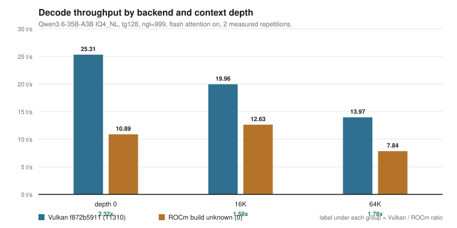
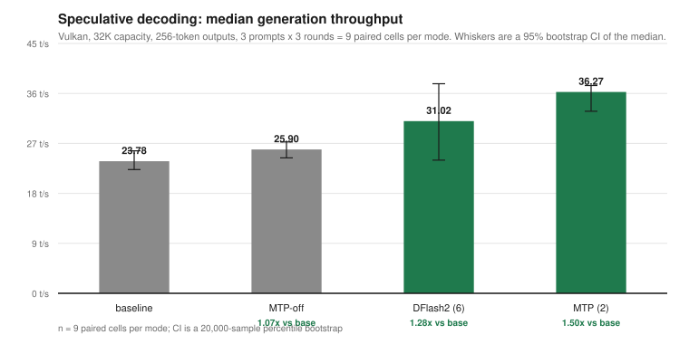
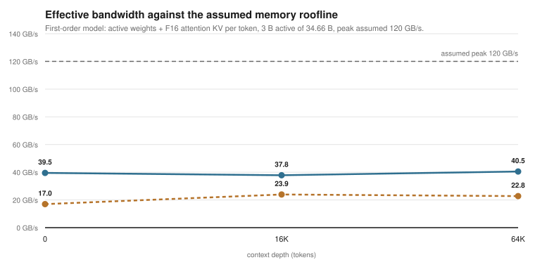

# Results

**Read this first:** the tables use different metrics. `llama-bench` rows are
decode-only `tg128`; server rows are end-to-end wall time; speculative rows are
generation tokens/second; agent rows are wall TPS including prefill and
reasoning. Do not compare rows across tables unless the conditions match.

Every row has a source. The source file is in this repository; its original path
and date are in [`data/provenance.md`](data/provenance.md).

## 0. Controlled backend comparison at 0.5 GB (2026-11-10)

This is the only comparison where Vulkan and ROCm ran under the same carve-out,
the same flags, the same models, and the same depths. It supersedes the archived
ratio as the primary evidence. Full discussion:
[`docs/related/backend-comparison-512mb.md`](docs/related/backend-comparison-512mb.md).

Carve-out: 512 MiB VRAM, 15,439 MiB GTT, 30,878 MiB host RAM. `tg128`,
threads 12, `-ngl 999 -fa on -b 2048 -ub 512 -p 512 -n 128`. Ratio is
Vulkan / ROCm.

| Model | Size | KV | Depth | Vulkan | ROCm | V/ROCm | Winner | Source |
|---|---|---:|---:|---:|---:|---:|---|---|
| LFM2.5-8B-A1B | 4.05 GiB | F16 | 0 | 43.88 | 30.97 | 1.42x | Vulkan | `campaign-vulkan-20261110-kv-recheck.csv` |
| LFM2.5-8B-A1B | 4.05 GiB | F16 | 16,384 | 30.32 | 22.38 | 1.35x | Vulkan | same |
| LFM2.5-8B-A1B | 4.05 GiB | F16 | 65,536 | 20.63 | 16.19 | 1.27x | Vulkan | `campaign-vulkan-20261110.csv` (noisy) |
| LFM2.5-8B-A1B | 4.05 GiB | Q8_0 | 0 | 39.74 | 25.57 | 1.55x | Vulkan | `campaign-vulkan-20261110-kv-recheck.csv` |
| LFM2.5-8B-A1B | 4.05 GiB | Q8_0 | 16,384 | 28.98 | 20.09 | 1.44x | Vulkan | same |
| LFM2.5-8B-A1B | 4.05 GiB | Q8_0 | 65,536 | 19.87 | 8.24 | 2.41x | Vulkan | `campaign-vulkan-20261110.csv` (noisy) |
| LFM2.5-8B-A1B | 8.69 GiB | F16 | 0 | 35.12 | 25.66 | 1.37x | Vulkan | `campaign-vulkan-20261110.csv` |
| LFM2.5-8B-A1B | 8.69 GiB | F16 | 16,384 | 18.27 | 22.55 | 0.81x | **ROCm** | same |
| LFM2.5-8B-A1B | 8.69 GiB | F16 | 65,536 | 9.74 | 19.72 | 0.49x | **ROCm** | same |
| Qwen3-VL-4B-Instruct | 4.70 GiB | F16 | 0 | 11.74 | 10.34 | 1.14x | Vulkan | same |
| Qwen3-VL-4B-Instruct | 4.70 GiB | F16 | 16,384 | 5.46 | 6.40 | 0.85x | **ROCm** | same |
| Qwen3.6-35B-A3B-MTP | 17.25 GiB | F16 | 0 | — | 17.66 | — | ROCm only | `campaign-rocm-20261110.csv` |
| Qwen3.6-35B-A3B-MTP | 17.25 GiB | F16 | 16,384 | — | 14.54 | — | ROCm only | same |

Parsed join: [`data/processed/backend-comparison-512mb.csv`](data/processed/backend-comparison-512mb.csv).

**What is robust:** Vulkan is faster on the 4.05 GiB model at every depth
(1.27x–1.42x on clean rows). For the 8.69 GiB model the ranking reverses:
Vulkan 1.37x at depth 0, ROCm 1.23x at 16K and 2.03x at 64K. The dense 4B model
also crosses over between 0 and 16K.

**What is not:** the two Vulkan 64K rows flagged noisy, and the cause of the
crossover. Three hypotheses (memory pressure, long-context kernels, thermal
drift) are listed in the comparison document; none is tested.

### 0a. The 35B at 0.5 GB

ROCm loads it via HIP unified memory into 30 GiB of host RAM and decodes at
17.66 t/s (depth 0) and 14.54 t/s (16K). GPU activity was verified by sampling
`gpu_busy_percent` (46–65% during the run), so this is GPU work, not a CPU
fallback. Vulkan cannot load the model at this setting: its total budget is
~14.5 GiB against a 17.25 GiB model.

## 1. Archived llama-bench: Vulkan vs ROCm

Model: `Qwen3.6-35B-A3B-UD-IQ4_NL.gguf`, 16.79 GiB, 34.66 B parameters,
`qwen35moe 35B.A3B IQ4_NL - 4.5 bpw`. `ngl=999`, flash attention on, `tg128`,
two measured repetitions after warmup.

| Backend | Build | Depth | t/s | ± | Vulkan / ROCm | Source |
|---|---|---:|---:|---:|---:|---|
| ROCm | `unknown (0)` | 0 | 10.89 | 1.61 | — | `data/raw/llama-bench-rocm-2026-09-30.txt:9` |
| ROCm | `unknown (0)` | 16,384 | 12.63 | 1.65 | — | `data/raw/llama-bench-rocm-2026-09-30.txt:16` |
| ROCm | `unknown (0)` | 65,536 | 7.84 | 0.85 | — | `data/raw/llama-bench-rocm-2026-09-30.txt:23` |
| Vulkan | `f872b5911 (11310)` | 0 | 25.31 | 0.75 | **2.32x** | `data/raw/llama-bench-vulkan-2026-10-01.txt:9` |
| Vulkan | `f872b5911 (11310)` | 16,384 | 19.96 | 0.12 | 1.58x | `data/raw/llama-bench-vulkan-2026-10-01.txt:16` |
| Vulkan | `f872b5911 (11310)` | 65,536 | 13.97 | 0.09 | 1.78x | `data/raw/llama-bench-vulkan-2026-10-01.txt:23` |

Ratios: [`data/processed/llama-bench-ratios.csv`](data/processed/llama-bench-ratios.csv).
Parsed rows: [`data/processed/llama-bench.csv`](data/processed/llama-bench.csv).



**Caveat:** this is not a controlled A/B. The builds differ, the per-run VRAM
carve-out is not recorded for either file, and ROCm’s own depth series is
non-monotonic (10.89 at depth 0, 12.63 at 16K). A separate ROCm server baseline
reached 18.17 t/s, so 10.89 is a lower bound. The defensible range is
**1.4x–2.3x**; see [`docs/limitations.md`](docs/limitations.md).

### 1a. Carve-out capacity, and a backend capability difference

Both BIOS VRAM settings were used on this machine. They are not a quality
setting; they move memory between the GPU pool and the host.

| Setting | GPU pool | GTT | Host-visible RAM | GPU-addressable total | 35B full offload |
|---|---:|---:|---:|---:|---|
| 0.5 GB | 512 MiB | 15,438 MiB | 30,877 MiB | 15,950 MiB (15.58 GiB) | ROCm works (unified memory) |
| 16 GB | 16,384 MiB | 7,638 MiB | 15,277 MiB | 24,022 MiB (23.46 GiB) | ROCm **fails**; Vulkan works |

The 24,022 MiB is the "24 GB usable" figure: 16 GiB reserved plus 7.46 GiB GTT,
matching the Vulkan budget in
[`docs/historical/2026-10-02-vulkan-post-reboot.md`](docs/historical/2026-10-02-vulkan-post-reboot.md).

**At 16 GB, ROCm cannot fully offload this model.** The weight buffer is
16,679.34 MiB against a 16,384 MiB pool, and host RAM is only 15,277 MiB:

```text
ROCm0 : AMD Radeon 890M Graphics (16384 MiB, 16210 MiB free)
CPU   : AMD Ryzen AI 9 HX 375 w/ Radeon 890M (15277 MiB, 15277 MiB free)
E allocating 16679.34 MiB on device 0: cudaMalloc failed: out of memory
E alloc_tensor_range: failed to allocate ROCm0 buffer of size 17489553920
```

At 0.5 GB the same model loads, because HIP unified memory can oversubscribe
into 30 GiB of host RAM. So the *smaller* carve-out is the one that works for
ROCm, and the larger one is the one that works for Vulkan.

Source: [`data/raw/historical/rocm-16gb-load-failure-2026-10-02.log`](data/raw/historical/rocm-16gb-load-failure-2026-10-02.log)
lines 6–7 and 159–161, and
[`data/raw/historical/carveout-states-2026-10-02.json`](data/raw/historical/carveout-states-2026-10-02.json).

> The allocation failing as one contiguous buffer is observed. The reason it
> cannot span VRAM and GTT is a hypothesis; see
> [`docs/hardware.md`](docs/hardware.md).

## 2. ROCm and Vulkan server session, 2026-10-02

End-to-end wall tokens/second, 512-token measured requests after a 64-token
warmup, 16K context, greedy, seed 42, thinking on unless noted. The main session
used three measured requests per configuration; the 512 MiB comparison below
used one per prompt.

| Run | Backend | Draft | Wall t/s | Draft acceptance | Source |
|---|---|---|---:|---:|---|
| `01b-rocm-baseline-clean` | ROCm | none | 17.93 | — | `data/processed/session-summary.csv:2` |
| `01c-rocm-baseline-no-graphs` | ROCm | none | 18.17 | — | `data/processed/session-summary.csv:3` |
| `11-rocm-baseline-confirmation` | ROCm | none | 21.26 | — | `data/processed/session-summary.csv:47` |
| `04-rocm-dflash2-gpu` | ROCm | DFlash2, graphs on | 7.19 | 0.45% | `data/processed/session-summary.csv:13` |
| `04b-rocm-dflash2-gpu-no-graphs` | ROCm | DFlash2, graphs off | **33.84** | 58.43% | `data/processed/session-summary.csv:14` |
| `11-rocm-dflash2-confirmation` | ROCm | DFlash2, graphs off | 30.32 | 58.43% | `data/processed/session-summary.csv:48` |
| `02r-vulkan-after-reboot-...-ngl999` | Vulkan | none | 25.63 | — | `data/processed/session-summary.csv:7` |
| `05r-vulkan-after-reboot-...-cpu-ngl999` | Vulkan | DFlash2 CPU | 35.62 | 65.78% | `data/processed/session-summary.csv:18` |
| `05r-vulkan-after-reboot-...-gpu-ngl999` | Vulkan | DFlash2 GPU | 40.81 | 65.78% | `data/processed/session-summary.csv:19` |
| `14-vulkan-post-reboot-...-nmax5` | Vulkan | DFlash2, 5 drafts | 41.23 | 78.47% | `data/processed/session-summary.csv:55` |
| `14-vulkan-post-reboot-...-nmax6` | Vulkan | DFlash2, 6 drafts | **42.20** | 72.74% | `data/processed/session-summary.csv:56` |
| `10-vulkan-...-baseline-correctness` | Vulkan | none, thinking off | 18.45 | — | `data/processed/session-summary.csv:45` |
| `10-vulkan-...-dflash2-correctness` | Vulkan | DFlash2, thinking off | 33.77 | 86.11% | `data/processed/session-summary.csv:46` |

The full 56-row index is
[`data/processed/session-summary.csv`](data/processed/session-summary.csv),
parsed from
[`data/raw/historical/session-summary-2026-10-02.txt`](data/raw/historical/session-summary-2026-10-02.txt).

The 42.20 t/s median is the middle of 37.98, 42.20, and 43.14 t/s. The same
runs recorded 91–94 °C and 45–52 W:
[`data/raw/historical/vulkan-nmax6-runs-2026-10-02.json`](data/raw/historical/vulkan-nmax6-runs-2026-10-02.json).
The 33.84 t/s median is the middle of 26.77, 33.84, and 38.83 t/s:
[`data/raw/historical/rocm-dflash2-runs-2026-10-02.json`](data/raw/historical/rocm-dflash2-runs-2026-10-02.json).

### 512 MiB ROCm vs historical 16 GiB Vulkan

From the 2026-10-02 ROCm comparison note. One measured response per prompt,
64K context capacity, 16,384 output tokens, thinking unrestricted, greedy seed
42, cache disabled. This is **not** an isolated backend or BIOS experiment.

| Prompt | ROCm t/s | Vulkan t/s | Vulkan / ROCm | ROCm acceptance | Source |
|---|---:|---:|---:|---:|---|
| 1 | 14.73 | 24.83 | 1.69x | 49.7% | `docs/historical/2026-10-02-rocm-512mb.md` |
| 2 | 18.72 | 25.42 | 1.36x | 68.6% | same |
| 3 | 15.64 | 33.00 | 2.11x | 51.4% | same |
| 4 | 15.18 | 30.92 | 2.04x | 51.2% | same |

## 3. Vulkan speculative decoding, 2026-10-18

Vulkan build `f872b5911 (11310)`, 32K context capacity, 256-token outputs,
3 synthetic prompts, 3 rounds, greedy, thinking off, cache reuse disabled,
9 measured requests per mode.

The speedup column is **paired**: the ratio is computed inside each
(prompt, round) cell and then summarised across the 9 cells. Comparing two
independent medians would ignore the pairing and overstate the uncertainty.
Intervals are a 20,000-sample percentile bootstrap of the median ratio, seeded
for reproducibility.

| Mode | Median generation t/s | 95% CI of median | Paired speedup vs baseline | 95% CI of speedup | Source |
|---|---:|---|---:|---|---|
| Baseline | 23.78 | 22.29–25.66 | 1.00x | — | `data/processed/speculative-stats.json` |
| DFlash2, 6 drafts | 31.02 | 23.98–37.74 | 1.28x | **1.00–1.56** | same |
| MTP-off | 25.90 | 24.38–27.25 | 1.07x | 1.05–1.10 | same |
| MTP, 2 drafts | **36.27** | 32.78–37.42 | **1.51x** | **1.37–1.63** | same |

**Read the intervals, not just the point estimates.** With 9 paired cells:

- **MTP is a clear win.** The 1.51x interval (1.37–1.63) excludes 1.00 by a
  comfortable margin, and the per-cell range is 1.30–1.63.
- **DFlash2 is marginal.** The 1.28x point estimate looks useful, but the
  interval (1.00–1.56) touches 1.00 and the per-cell range runs from 0.94 to
  1.69. On this sample, DFlash2 is not distinguishable from "no change" for
  some prompts. The earlier claim of a solid 1.28x was too confident; the data
  support "probably faster, possibly not."
- **The MTP-off control is slightly faster than the baseline target** (1.07x,
  interval 1.05–1.10). The two files are different GGUFs, so this is a
  weight-file difference, not a decoding effect. It is why the MTP-on vs
  MTP-off pair is the cleaner comparison: 1.37x (1.26–1.53).

The statistics are reproducible:

```bash
python3 scripts/stats.py
```

Per-prompt medians are in
[`docs/related/speculative-decoding.md`](docs/related/speculative-decoding.md).
The 24 measured requests are in
[`data/processed/speculative-measurements.csv`](data/processed/speculative-measurements.csv).



## 4. Long-context KV cache, 2026-10-18

Vulkan, 65K context capacity, actual depths approximately 4K/32K/61K, 256-token
outputs, 2 rounds, speculative modes only. Retrieval is a 9-field synthetic
check.

| Depth | Mode | KV | Generation t/s | Prompt t/s | Acceptance | Retrieval | Source |
|---:|---|---|---:|---:|---:|---:|---|
| 4,096 | MTP | F16 | 33.67 | 334.80 | 81.4% | 9/9 | `data/processed/long-context-summary.json` |
| 4,096 | MTP | Q8_0 | 38.15 | 430.77 | 84.2% | 9/9 | same |
| 4,096 | DFlash2 | F16 | 32.24 | 339.90 | 57.3% | 9/9 | same |
| 4,096 | DFlash2 | Q8_0 | 32.66 | 370.70 | 57.0% | 9/9 | same |
| 32,768 | MTP | F16 | 25.40 | 195.04 | 82.8% | 9/9 | same |
| 32,768 | MTP | Q8_0 | 29.47 | 362.03 | 82.8% | 9/9 | same |
| 32,768 | DFlash2 | F16 | 27.76 | 224.72 | 57.4% | 9/9 | same |
| 32,768 | DFlash2 | Q8_0 | 23.52 | 313.36 | 52.4% | 9/9 | same |
| 61,440 | MTP | F16 | 21.99 | 133.21 | 83.2% | 9/9 | same |
| 61,440 | MTP | Q8_0 | 22.00 | 270.13 | 81.4% | 9/9 | same |
| 61,440 | DFlash2 | F16 | 22.13 | 155.00 | 54.8% | 9/9 | same |
| 61,440 | DFlash2 | Q8_0 | 18.65 | 265.08 | 52.6% | 9/9 | same |

The 24 measured requests are in
[`data/processed/long-context-measurements.csv`](data/processed/long-context-measurements.csv).
The method and caveats are in
[`docs/related/long-context.md`](docs/related/long-context.md).

## 5. Coding workloads

### 5.1 Coding-agent harness, 2026-10-13

Vulkan, 32K context, 3 tasks, 3 repetitions, sandboxed scoring. **Wall TPS**
includes prefill, reasoning, generation, and HTTP transport; it is not pure
decode. Selected rows; the full 12-configuration table is
[`data/processed/agent-bench-summary.csv`](data/processed/agent-bench-summary.csv).

| Configuration | Attempts | Completion | Whole-task pass | Wall TPS | Draft acceptance | Source |
|---|---:|---:|---:|---:|---:|---|
| `qwen_raw` | 3 | 1.00 | 0.33 | 24.55 | — | `data/processed/agent-bench-summary.csv` |
| `qwen_dflash2_n3` | 3 | 1.00 | 0.00 | **36.99** | 77.7% | same |
| `qwen_dflash2_n4` | 3 | 1.00 | 0.33 | 34.42 | 73.3% | same |
| `qwen_dflash2_n5` | 3 | 1.00 | 0.00 | 35.86 | 65.7% | same |
| `qwen_dflash2_n6` | 3 | 1.00 | 0.00 | 33.55 | 64.7% | same |
| `qwen_coder_q5_k_m` | 3 | 0.00 | 0.00 | — | — | same |
| `lfm_iq4_nl` | 6 | 0.33 | 0.00 | 69.59 | — | same |
| `lfm_q8_k_xl` | 6 | 0.83 | 0.00 | 37.42 | — | same |

The run directory is `20261013-213047-183018`; the documentation also references
a smoke run `20261013-211138` that is not present. The present run is the one
included here.

### 5.2 ROCm coding-quality matrix, 2026-10-02

ROCm, 512 MiB reserved VRAM, 64K capacity, 4,096 output tokens per turn, max 8
turns, 27 acceptance checks. One run per condition, fixed order, 65.75 minutes
total. Full review: [`docs/related/coding-quality.md`](docs/related/coding-quality.md).

| Condition | Checks passed | Elapsed min | Generation wall t/s | Source |
|---|---:|---:|---:|---|
| Baseline, thinking off | 22/27 | 20.10 | 5.82 | `docs/related/coding-quality.md` |
| DFlash2-six, thinking off | **24/27** | **11.71** | 6.22 | same |
| DFlash2-six, thinking budget 2048 | 9/27 | 13.71 | 10.79 | same |
| Baseline, thinking budget 2048 | 8/27 | 20.23 | 9.51 | same |

The review explicitly says the 2048-token comparison is confounded by a
test-freeze policy and tool-protocol overhead. These are not a quality
leaderboard.

## 6. Roofline: theoretical vs measured bandwidth

Assumptions: 3 B active parameters out of 34.66 B, 16.79 GiB target, F16 KV
cache at 20,480 bytes/token (10 attention layers; the 30 SSM layers are not
modeled), peak 120 GB/s (LPDDR5X-7500, 128-bit). The exact RAM speed is not
recorded; 102.4 and 128 GB/s are the sensitivity bounds.

| Backend | Depth | t/s | Weight GB/token | KV GB/token | Total GB/token | Effective GB/s | % of 120 GB/s |
|---|---:|---:|---:|---:|---:|---:|---:|
| ROCm | 0 | 10.89 | 1.560 | 0.000 | 1.560 | 16.99 | 14.2% |
| ROCm | 16,384 | 12.63 | 1.560 | 0.336 | 1.896 | 23.95 | 20.0% |
| ROCm | 65,536 | 7.84 | 1.560 | 1.342 | 2.903 | 22.76 | 19.0% |
| Vulkan | 0 | 25.31 | 1.560 | 0.000 | 1.560 | 39.49 | 32.9% |
| Vulkan | 16,384 | 19.96 | 1.560 | 0.336 | 1.896 | 37.84 | 31.5% |
| Vulkan | 65,536 | 13.97 | 1.560 | 1.342 | 2.903 | 40.55 | 33.8% |

Computed by [`scripts/roofline.py`](scripts/roofline.py); values in
[`data/processed/roofline.csv`](data/processed/roofline.csv). The interpretation
and hypotheses are in [`analysis/roofline.md`](analysis/roofline.md).



## 7. What is not recorded

- Exact original `llama-bench` CLI and binary hash.
- BIOS version and the per-run VRAM carve-out.
- RAM type/speed/part number.
- Wall power and locked clocks; partial temperature/power sensors only for one
  Vulkan configuration.
- ROCm runtime/image version; the runtime is absent now.
- The target and draft GGUFs; sizes and hashes are recorded, but the files are
  absent.
- The agent smoke run `20261013-211138`.
- NPU results; the NPU is present but unused.

See [`docs/limitations.md`](docs/limitations.md) for what each gap means and
what would close it.
