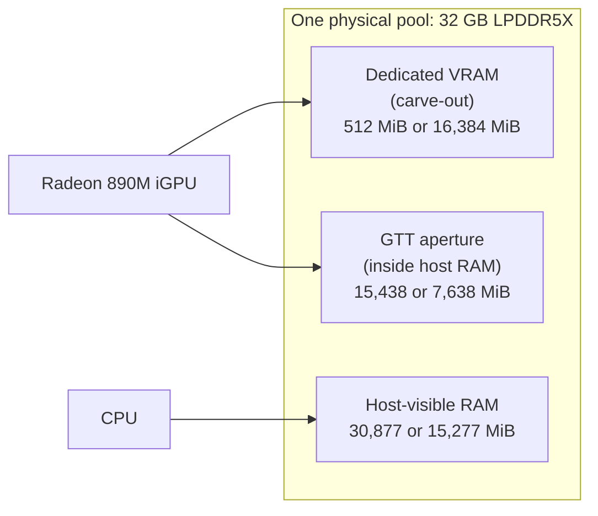

# Memory on a UMA APU: RAM, VRAM, GTT and "shared memory"

On an AMD APU there is one physical pool of LPDDR5X. The CPU and the iGPU both
read it, and the firmware splits it into a dedicated GPU region and a host
region. Most confusion about "how much VRAM do I have" comes from mixing up four
different numbers. This page defines them, gives the measured values on this
machine, and says what each one limits.

## The four numbers

| Number | What it is | Where to read it |
|---|---|---|
| **Physical RAM** | the whole pool, e.g. 32 GB | `free -h`, `MemTotal` |
| **VRAM carve-out** | reserved for the GPU, invisible to the OS | `mem_info_vram_total` |
| **GTT** | aperture through which the GPU maps host RAM | `mem_info_gtt_total` |
| **GPU-addressable total** | carve-out + GTT | sum of the two |

"Shared memory" in tools like `radeontop` or `amdgpu_top` is **GTT**. It is not
extra memory: it is a window into the host pool.

## How they relate



Two rules follow:

1. **Carve-out + host-visible RAM ≈ physical RAM.** Raising the carve-out takes
   memory away from the host.
2. **GTT is a subset of host RAM, not an addition to it.** A 12 GB GTT does not
   give you 12 GB more memory; it lets the GPU map up to 12 GB of what the host
   already has.

## Measured states on this machine

| | 0.5 GB carve-out | 16 GB carve-out |
|---|---:|---:|
| VRAM carve-out | 512 MiB | 16,384 MiB |
| GTT | 15,438 MiB | 7,638 MiB |
| Host-visible RAM | 30,877 MiB | 15,277 MiB |
| GPU-addressable total | 15,950 MiB (15.58 GiB) | 24,022 MiB (23.46 GiB) |
| Vulkan heaps | 5.19 + 10.38 GiB | 7.82 + 14.92 GiB |
| ROCm device pool | 15,438 MiB | 16,384 MiB |

The "24 GB usable" figure people quote for the 16 GB setting is this sum:
16 GiB of dedicated memory plus 7.6 GiB of GTT.

## Why the same model loads on one backend and not the other

The totals are not what the allocator sees.

- **Vulkan** exposes two heaps and can place tensors across both. At 16 GB that
  is 7.82 GiB host-visible plus 14.92 GiB device-local, so a 17.25 GiB model
  fits by spanning them.
- **ROCm** reports one device pool. A single 16,679.34 MiB allocation does not
  fit a 16,384 MiB pool, so the same model fails to load at 16 GB even though
  the total is larger.

Practical rule: **model + KV cache + a few hundred MiB of buffers must fit the
pool the backend actually allocates from.** For Vulkan that can be the sum of
heaps; for ROCm it is the device pool.

## Reading the numbers

```bash
# carve-out, GTT, host
for f in /sys/class/drm/card*/device/mem_info_vram_total \
         /sys/class/drm/card*/device/mem_info_gtt_total; do
  printf '%-22s %s MiB\n' "$(basename "$f")" "$(( $(cat "$f") / 1048576 ))"
done
free -m | sed -n '1,2p'

# carve-out index and option table
cat /sys/class/drm/card*/device/uma/carveout
cat /sys/class/drm/card*/device/uma/carveout_options

# Vulkan heaps
vulkaninfo | grep -A6 'memoryHeaps: count'

# one command that prints all of it
./scripts/carveout.sh --show
```

## Changing them

> Both of these are firmware writes. See [`../DISCLAIMER.md`](../DISCLAIMER.md).

**Carve-out** (takes effect immediately, persists across reboot):

```bash
echo 7 | sudo tee /sys/class/drm/card*/device/uma/carveout   # 16 GB
sudo amd-smi set -g 0 -m 7                                   # same
```

**GTT** (system-wide, **requires a reboot**):

```bash
sudo amd-smi set -G 12       # request 12 GB
sudo amd-smi reset --gtt     # restore the default
```

`amd-smi` reports "Reboot required for changes to take effect", and
`mem_info_gtt_total` does not change until then.

`ttm.pages_limit` is **not** the GTT aperture. Writing it changes a TTM
allocation cap and leaves `mem_info_gtt_total` unchanged; on this machine the
cap is 3,952,376 pages (15.08 GiB) while the aperture is 7,638 MiB at 16 GB.

## What each number costs you

| Raise | You gain | You lose |
|---|---|---|
| Carve-out | dedicated GPU memory; 1.4–3.0x faster decode for models that fit | host RAM for the OS and CPU inference |
| GTT | a larger window for the GPU to map host RAM | nothing directly, but it can only map memory the host already has |

On this machine, going from 0.5 GB to 16 GB moved about 15.5 GiB from host to
GPU. That is why the 35B runs at 24.19 t/s on Vulkan at 16 GB but only 13.78 t/s
on the CPU there, against 18.38 t/s at 0.5 GB.

## What is not known

- Whether a larger GTT changes model loading or throughput. It was set once
  (12 GB, pending reboot) and reset before measurement.
- Whether GTT can be configured above host-visible RAM.
- The exact allocator behaviour that makes Vulkan span heaps and ROCm not.

These are listed in [`limitations.md`](limitations.md).
